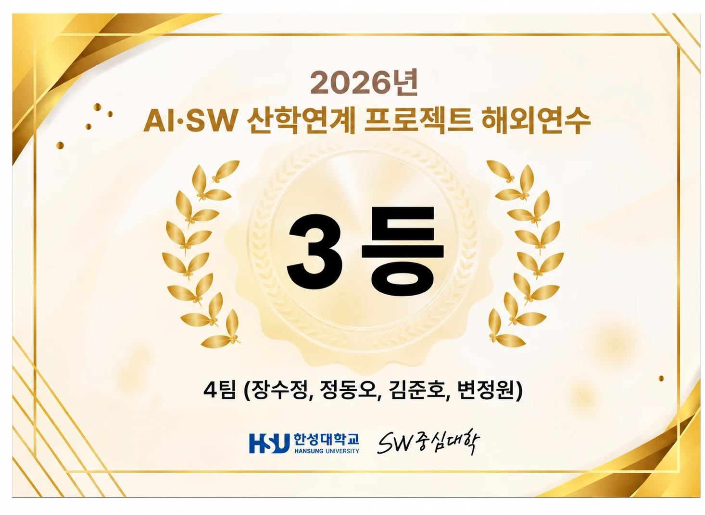

## 📄 Projects
> ####  [**_MCPeak_**](https://github.com/2026-Engineering-Contest/MCPeak) 2026.07 – 2026.10
  MCP 서버를 코드로 자동 테스트하는 오픈소스 프레임워크 · 팀, 외부 호출 녹화·재생과 대시보드 담당

> ####  [**_PosNexa_**](https://github.com/ddxng5/PosNexa) 2026.01 – 2026.02
  역할별 화면을 나눈 음식점 주문·결제·매출 관리 POS 시스템

> ####  [**_menlo-robotics_**](https://github.com/ddxng5/menlo-robotics) 2026.06 – 2026.07
  LLM이 판단하고 코드가 실행하는 큐브 분류 로봇 에이전트 · 팀 워크숍, Level 0 에이전트 담당

> ####  [**_Smart Car Garage_**](https://github.com/ddxng5/smartcargarage) 2025.09 – 2025.12
  라즈베리파이 기반 주차 보조 및 차고 환경 모니터링 IoT 시스템

> ####  [**_RecycleHelper_**](https://github.com/ddxng5/RecycleHelper) 2026.05 – 2026.06
  분리배출 방법 검색과 동네 수거 일정 알림을 제공하는 안드로이드 앱

 

## 🛠 Tech Stack

### Language & Framework
         

### Database

### Other
         

 

## 🏆 Achievements
<!-- TODO: 오픈소스개발자대회 날짜를 알면 [YYYY.MM.DD] 형식으로 앞에 붙여 주세요 -->
- 

  
[2026.07.06] 싱가포르 AI·SW 산학연계 해외연수 최종발표 <strong>3위</strong>

  
  

- 2026 오픈소스개발자대회 **우수작 선정**

 

## 📫 Contact me

  
  

